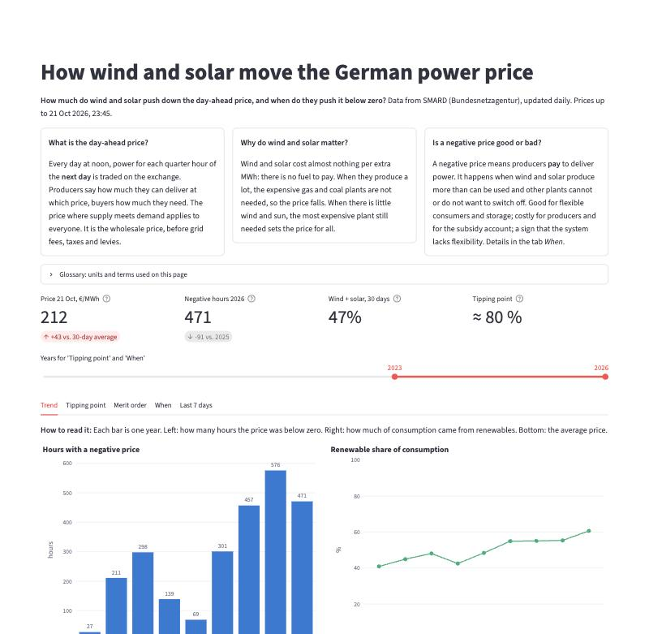

# SMARD Energy Pipeline

[](https://github.com/Pauluc26/smard-energy-pipeline/actions/workflows/pipeline.yml)
[](https://github.com/Pauluc26/smard-energy-pipeline/actions/workflows/tests.yml)

**[→ Open the live dashboard](https://smard-energy-pipeline-v1.streamlit.app)** (updated daily; on the free tier it may need ~30 s to wake up)

A daily-updating data pipeline for the German electricity market. It pulls generation by source, consumption and day-ahead prices from [SMARD](https://www.smard.de) (Bundesnetzagentur), models them in DuckDB with dbt and feeds a dashboard that asks: **how much do wind and solar push down the electricity price, and when do they push it below zero?**

Why this project: German power prices now go negative several hundred hours a year. Explaining when and why needs data that is reliable and fresh every day, so the focus here is the engineering around the analysis: incremental loading, data tests and a scheduled pipeline.

[](https://smard-energy-pipeline-v1.streamlit.app)

## Architecture

```
SMARD API ──► src/ingest (Python) ──► data/raw/*.parquet ──► dbt + DuckDB ──► data/marts/*.parquet ──► dashboard
                                              │                       │ 27 tests            │
                                              └────────── data branch (one commit, force-pushed) ┘
                         GitHub Actions runs all of it daily at 05:00 UTC
```

The daily job (`.github/workflows/pipeline.yml`): pull the stored data from the `data` branch → load new data → build and test the models → export the marts → publish. Nothing is published if a test fails, and the next run re-loads the missed days.

## Project structure

```
smard-energy-pipeline/
├── SCOPE.md          # what is in and out, and why
├── docs/api_notes.md # verified facts about the SMARD API
├── src/
│   ├── series.py     #   which SMARD series are loaded
│   ├── smard.py      #   API client (retries, throttling) and chunk parsing
│   ├── storage.py    #   Parquet raw layer with idempotent upserts
│   └── ingest.py     #   backfill / update entry point
├── transform/        # dbt project (DuckDB)
│   ├── seeds/series.csv   # series metadata + data-quality thresholds (shared with src/)
│   ├── models/            #   staging → intermediate → marts (quarter hour, hour, day)
│   └── tests/             #   data tests (gaps, ranges, freshness, physical identities)
├── scripts/data_branch.sh  # pull / push the data branch
├── notebooks/01_explore.ipynb  # exploration: finding the story for the dashboard
├── tests/            # unit tests on recorded API responses (no network)
├── data/raw/         # series=<id>/month=<YYYY-MM>.parquet, written by the pipeline
├── dashboard/        # Streamlit app (app.py) and its tested calculations (analysis.py)
└── .github/workflows # CI and the daily pipeline run
```

## Quick start

```bash
make install
make pull-data  # get the published data (instead of a 25-min backfill)
make test       # 28 unit tests, no network
make backfill   # or: full history from SMARD since Oct 2018, ~25 min
make update     # re-load the last two weeks
make transform  # dbt: build the models and run 27 data tests (~10 s)
make export     # marts as Parquet for the dashboard
make dashboard  # open the dashboard locally
```

How the loading works:

- **Incremental:** `update` re-loads from two weeks before the newest stored value. That picks up SMARD's late corrections and closes gaps if runs were missed.
- **Idempotent:** writes are upserts on `(series_id, ts_utc)`, so running the same load twice leaves the files byte-identical.
- **Robust:** retries with backoff on transient HTTP errors; one failing series does not stop the others, but the run exits with an error.
- **Tested data:** dbt checks uniqueness, a gap-free 15-minute axis, plausible ranges and freshness per series, and two physical identities (forecast parts add up to the total; residual load = load − wind − solar).
- **Time:** everything is stored in UTC at quarter-hour grain. Clock-change weeks (668 / 676 quarter hours) need no special handling that way. The DuckDB session is pinned to UTC too, otherwise `date_trunc` follows the machine's time zone and results differ between a laptop and CI.

## What the data shows

Details and charts: [`notebooks/01_explore.ipynb`](notebooks/01_explore.ipynb).

- **Negative prices became normal:** 27 hours in late 2018, 457 in 2024, 576 in 2025, following the renewable share (41 % → 55–61 %).
- **Tipping point:** below a wind + solar share of ~60 % of consumption the price is practically never negative; at 90–100 % it is negative half of the time.
- **The effect depends on fuel prices:** within a month, +10 percentage points of wind and solar go along with a price that is ~6 €/MWh lower in 2018–2020, ~27 € in the 2021–2022 gas crisis and ~16 € since 2023.
- **Negative prices are a solar phenomenon:** 10:00–16:00, April to September, almost four times as often on weekends.
- **Hourly data hides events:** since quarter-hour prices started (Oct 2025), one in six hours with a negative quarter hour is positive on average.

Scope and decisions: [`SCOPE.md`](SCOPE.md).

## Data

Source: Bundesnetzagentur | SMARD.de, licensed under [CC BY 4.0](https://creativecommons.org/licenses/by/4.0/).
